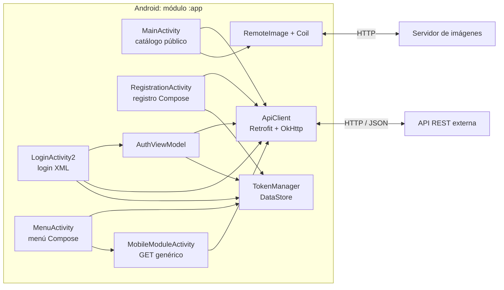

# Arquitectura

## Vista general

El proyecto es una app cliente Android de un solo módulo Gradle, `:app`, con namespace y `applicationId` `com.example.emy`. No contiene un módulo de servidor ni un módulo de dominio separado. Las pantallas principales están implementadas con Jetpack Compose; la pantalla de login usa un layout XML y vistas Android tradicionales.

La navegación entre pantallas se realiza con Android Activities e Intents explícitos. Aunque `androidx.navigation:navigation-compose` figura como dependencia, el recorrido de pantallas observado no utiliza un `NavHost`: el catálogo, el menú, el registro, el login y los módulos se abren como Activities.

## Capas y responsabilidades

### Presentación

Las Activities y las funciones `@Composable` dibujan la interfaz, validan ciertos campos y reaccionan a acciones del usuario.

- `MainActivity`: catálogo, inicio, búsqueda, filtro por categoría y detalle.
- `LoginActivity2`: formulario XML, validación de entrada, observación del estado de autenticación y transición al menú.
- `RegistrationActivity`: formulario Compose, carga de tipos de documento y envío del registro.
- `MenuActivity`: saludo, información local del usuario y selección de secciones/módulos.
- `MobileModuleActivity`: consulta de una ruta de API y representación genérica del JSON recibido.

La navegación y el contenido visible no sustituyen la autorización del servidor. La app decide qué módulos presentar a partir de los roles que lee del usuario local.

### Estado y lógica de autenticación

`AuthUiState.kt` define los estados `Idle`, `Loading`, `Success` y `Error`. `AuthViewModel.kt` ejecuta la solicitud de inicio de sesión, interpreta la respuesta y guarda la sesión cuando tiene éxito. `AuthViewModelFactory.kt` proporciona las dependencias que necesita el ViewModel.

El ViewModel interviene en el login, no en todas las solicitudes de red ni en todo el estado del catálogo. La comprobación de sesión en `LoginActivity2` y la carga del usuario en el menú se coordinan desde las propias Activities.

### Acceso remoto

`ApiClient.kt` centraliza la creación de Retrofit, Gson, OkHttp, interceptores y los métodos de `ApiService`. Las pantallas solicitan operaciones a esa interfaz en lugar de construir conexiones HTTP por su cuenta. La API devuelve JSON y las pantallas extraen campos mediante las estructuras esperadas por cada flujo.

`ImageUrlResolver.kt` normaliza URL de imágenes; `RemoteImage.kt` las carga con Coil y un placeholder. Las imágenes usan el host base del backend cuando la URL devuelta es relativa o tiene un host local de loopback.

### Persistencia local

`TokenManager.kt` guarda `auth_token` y `auth_user` en el DataStore Preferences llamado `user_prefs`. La persistencia mantiene la sesión entre aperturas, pero en el código observado no hay cifrado explícito de esos valores. `clearToken()` elimina tanto token como usuario.

## Relación de los componentes

1. La Activity recibe la acción del usuario.
2. Para una operación remota, llama a `ApiService`, directamente o a través de `AuthViewModel`.
3. Retrofit/OkHttp construye y ejecuta la solicitud contra la base de API configurada.
4. Gson convierte JSON en los tipos declarados o el contenido se procesa como `JsonObject`.
5. La pantalla transforma los datos para su presentación.
6. La sesión exitosa se guarda con `TokenManager`; las pantallas siguientes leen esos valores.

El catálogo y los módulos también usan helpers locales para interpretar variaciones de nombres y formas de JSON. No se observa una capa de repositorios dedicada que desacople todas las Activities del cliente HTTP.

## Navegación por roles

`MobileNavigation.kt` define `StoreModule`, `ModuleSection`, `readRoles()` y `sectionsFor()`. El menú se arma localmente en función de roles como `administrador`, `bodeguero`, `mensajero` y `cliente`; el alias `admin` se normaliza a `administrador`. `HappyKidsNavigationDrawer` presenta las secciones y módulos.

La mayoría de las entradas abre `MobileModuleActivity` con un título y una ruta relativa. El módulo efectúa un GET y muestra la respuesta en forma genérica. La presencia de una entrada en el menú no implica que existan formularios para modificar esos datos.

## Configuración y entornos

Las propiedades Gradle `backendBaseUrl`, `apiBaseUrl`, `apiLoginPath`, `apiLoginUserField` y `apiLoginPasswordField` generan constantes `BuildConfig` durante la compilación. Sus valores predeterminados se describen en [FLUJOS_DE_DATOS.md](FLUJOS_DE_DATOS.md).

La configuración de red principal bloquea tráfico HTTP sin cifrar; la variante de depuración permite cleartext para el backend local. Por ello, que una compilación debug se conecte por HTTP no significa que una versión release pueda hacerlo.

## Límites arquitectónicos observados

- La API y las imágenes dependen de sistemas externos no contenidos en el repositorio.
- El token persistido no se incorpora correctamente en el encabezado Authorization: `ApiClient.kt` asigna el literal `******`. Las llamadas que dependen de sesión pueden ser rechazadas.
- Las decisiones de menú se basan en roles del usuario local; la autorización real debe aplicarse en el backend.
- Los módulos de administración, bodega y mensajería son lectores genéricos de JSON, no implementaciones completas de cada proceso.
- No se ve en el cliente una acción de compra/agregar al carrito desde el detalle de producto.
