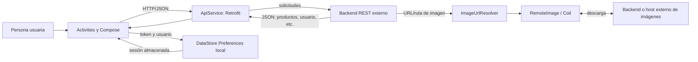
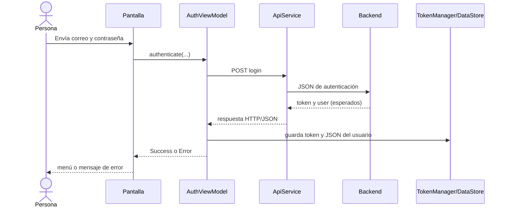

# Flujos de datos

## Orígenes y destinos

## Configuración de direcciones

En `app/build.gradle.kts`, el proyecto lee propiedades Gradle y define los valores predeterminados:

| Propiedad | Valor predeterminado | Propósito |
|---|---|---|
| `backendBaseUrl` | `http://10.0.2.2:3000/` | Host base, también utilizado para completar/resolver URL de imágenes. |
| `apiBaseUrl` | `${backendBaseUrl}api/v1/` | Base Retrofit para llamadas API. |
| `apiLoginPath` | `login` | Ruta relativa para inicio de sesión. |
| `apiLoginUserField` | `email` | Nombre del campo de usuario en el JSON de login. |
| `apiLoginPasswordField` | `password` | Nombre del campo contraseña en el JSON de login. |

Las dos URL se normalizan para acabar con `/`. El build genera `BuildConfig.BACKEND_BASE_URL`, `API_BASE_URL`, `API_LOGIN_PATH`, `API_LOGIN_USER_FIELD` y `API_LOGIN_PASSWORD_FIELD`. Se pueden pasar valores diferentes con propiedades `-Pnombre=valor` al ejecutar Gradle.

`10.0.2.2` se usa para que un Android Emulator alcance el loopback del PC host. No representa al host del PC desde un teléfono físico ni es una URL de backend utilizable universalmente.

## Flujos HTTP observados

Con los valores predeterminados, las rutas relativas principales son:

| Acción | Verbo y ruta API | Respuesta esperada por el cliente |
|---|---|---|
| Cargar categorías públicas | `GET /categorias` | Colección de categorías con una clave reconocida por el parser. |
| Cargar catálogo público | `GET /productos-publicos` | Lista directa o datos bajo claves como `products`, `productos`, `data`, `items` o `results`. |
| Filtrar por categoría | `GET /productos-publicos?categoria=...` | Productos correspondientes a la categoría solicitada. |
| Autenticar | `POST /login` (ruta configurable) | JSON que incluye `token` y objeto `user`. Las claves del usuario y contraseña del request son configurables. |
| Validar/consultar sesión | `GET /me` | Respuesta con el usuario bajo `user`. |
| Obtener tipos de documento | `GET /tipos-documento` | Respuesta con una colección bajo `documentTypes`. |
| Registrar cuenta | `POST /registro` | Respuesta con token y usuario si el registro inicia sesión. |
| Cargar un módulo | `GET <ruta relativa del módulo>` | Objeto/lista JSON que la Activity representa genéricamente. |

`ApiService` ofrece además métodos genéricos GET/POST/PUT/PATCH/DELETE para rutas dinámicas, aunque la pantalla de módulo descrita usa GET.

## Catálogo: transformación de datos

1. `MainActivity` solicita categorías y productos públicos.
2. El parser intenta reconocer contenedores JSON y nombres alternativos de campos para títulos, imágenes, precios, stock, categoría y variantes.
3. La UI presenta hasta seis productos en Inicio y el conjunto disponible en Catálogo.
4. La búsqueda local por texto se aplica a Inicio. El selector de categoría solicita/filtra la lista del catálogo.
5. El precio se formatea para la configuración regional `es-CO`.

Si el backend devuelve una forma no contemplada, el parser puede dejar una lista vacía o no mostrar algunos campos. La documentación no supone campos que el servidor no haya enviado.

## Login y registro

El registro primero descarga tipos de documento; el formulario envía los campos registrados y valida respuesta con token/usuario. Las comprobaciones de formato locales no garantizan que el servidor acepte la cuenta.

## Persistencia

`TokenManager` almacena `auth_token` y `auth_user` en preferencias de DataStore llamadas `user_prefs`. `MenuActivity` lee el usuario guardado para el saludo y roles; `LoginActivity2` puede validar la sesión contra `GET me`; el logout elimina los datos locales. El código observado no cifra explícitamente los valores y no implementa un logout remoto.

## Encabezado de autenticación: comportamiento actual

El interceptor de OkHttp en `ApiClient.kt` obtiene el token, pero asigna a `Authorization` el literal `******` en lugar de su valor. Por ello el token persistido no llega correctamente al backend en las solicitudes que pasan por ese interceptor. Esto puede causar fallos en `GET me` y endpoints que requieran autenticación. Es una limitación documentada del código, no una recomendación de contrato del backend.

## Imágenes

El producto proporciona un campo de imagen que `MainActivity` busca entre varios alias. Si falta, el código puede generar una ruta referencial por ID bajo `/media/productos/`. `ImageUrlResolver`:

- mantiene URL absolutas externas HTTP(S);
- completa rutas relativas con el host del backend;
- sustituye hosts loopback por el host configurado para que no apunten a un destino inutilizable en otro dispositivo;
- rechaza valor vacío, protocolo no HTTP(S) y URL protocol-relative.

`RemoteImage` pasa la URL a Coil, usa cachés de memoria y almacenamiento y muestra `image_placeholder.xml` en ausencia/error. Las imágenes remotas requieren conectividad y que los archivos existan en el servidor.

## Red por variante

`AndroidManifest.xml` conecta `@xml/network_security_config`. La configuración base bloquea cleartext; la variante debug permite solicitudes HTTP sin TLS. La URL predeterminada es HTTP, de modo que está pensada para desarrollo y no implica que release pueda conectarse por HTTP.
