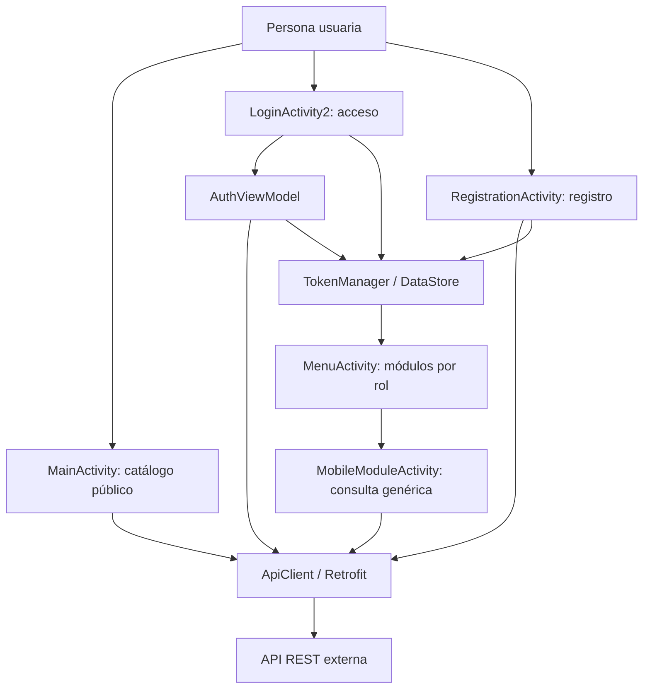

# Emy — documentación del proyecto

## Descripción general

Emy es el cliente móvil Android de una tienda de productos infantiles asociada al nombre Three Happy Kids. Presenta un catálogo público y ofrece pantallas de inicio de sesión, registro y navegación por módulos que dependen del rol del usuario. La app consulta productos, categorías, cuenta y otros datos desde una API HTTP externa; no incluye el servidor ni una base de datos propia.

Su objetivo es facilitar el acceso móvil al catálogo y a las secciones de tienda, administración, bodega, mensajería y cuenta desde una sola aplicación. El código implementa la presentación e integración HTTP; las respuestas y la autorización final dependen del backend.

## Funcionalidades que se observan en el código

- Inicio público y catálogo de productos y categorías.
- Búsqueda en la lista de productos del inicio y filtro del catálogo por categoría.
- Detalle de producto con imágenes, precio, existencias y variantes cuando esos datos los proporciona la API.
- Inicio de sesión, registro y persistencia local de la información de sesión.
- Selección de módulos de navegación según los roles presentes en el usuario guardado.
- Lectura de datos de módulos mediante solicitudes GET y presentación de respuestas JSON genéricas.
- Carga de imágenes remotas con placeholder y resolución de rutas relativas.

El botón del detalle invita a iniciar sesión para comprar, pero el código actual no implementa una acción de agregar el producto al carrito. Las pantallas de administración, bodega y mensajería tampoco son todavía interfaces CRUD específicas: los módulos abren una pantalla de consulta genérica.

## Tecnologías principales

- Kotlin, Android y Jetpack Compose con Material 3.
- Una Activity de login basada en un layout XML.
- Retrofit, Gson y OkHttp para la API REST.
- DataStore Preferences para token y datos de usuario.
- Coil para imágenes remotas.
- Gradle 9.0.0 y Android Gradle Plugin 9.0.0-alpha06.

La lista completa de versiones y el uso de cada dependencia están en [TECNOLOGIAS_Y_DEPENDENCIAS.md](TECNOLOGIAS_Y_DEPENDENCIAS.md).

## Arquitectura resumida

El proyecto tiene un solo módulo Android, `:app`. Las Activities reciben eventos de interfaz y coordinan el acceso a la capa de red; `AuthViewModel` gestiona el estado del inicio de sesión; `ApiClient` configura Retrofit y OkHttp; y `TokenManager` persiste la sesión localmente.



Consulta [ARQUITECTURA.md](ARQUITECTURA.md) y [FUNCIONAMIENTO.md](FUNCIONAMIENTO.md) para los flujos detallados.

## Requisitos para ejecutar

Se necesita Java 17 o posterior para Gradle 9, Android SDK con la plataforma 36 y acceso a Internet para descargar Gradle y las dependencias. Para utilizar el catálogo y la autenticación hace falta, además, un backend compatible y accesible desde el dispositivo.

En Windows, desde la raíz del proyecto:

```powershell
.\gradlew.bat :app:assembleDebug
.\gradlew.bat :app:testDebugUnitTest
```

El primer comando genera el APK de depuración en `app/build/outputs/apk/debug/app-debug.apk`. Para instalarlo en un teléfono conectado y autorizado mediante ADB:

```powershell
.\gradlew.bat :app:installDebug
```

El Android Emulator utiliza por defecto `http://10.0.2.2:3000/` como dirección del servidor del PC. Un teléfono físico no puede usar esa dirección para alcanzar el PC: configura una URL accesible desde el teléfono. La guía completa está en [CONFIGURACION_E_INSTALACION.md](CONFIGURACION_E_INSTALACION.md).

## Documentación

- [ARQUITECTURA.md](ARQUITECTURA.md): capas, relaciones y decisiones observables.
- [ESTRUCTURA_DEL_PROYECTO.md](ESTRUCTURA_DEL_PROYECTO.md): directorios y archivos relevantes.
- [FUNCIONAMIENTO.md](FUNCIONAMIENTO.md): pantallas y flujos de uso.
- [TECNOLOGIAS_Y_DEPENDENCIAS.md](TECNOLOGIAS_Y_DEPENDENCIAS.md): stack y dependencias con versión.
- [CONFIGURACION_E_INSTALACION.md](CONFIGURACION_E_INSTALACION.md): preparación, configuración, compilación y prueba.
- [MODULOS_Y_COMPONENTES.md](MODULOS_Y_COMPONENTES.md): responsabilidades e interfaces de componentes.
- [FLUJOS_DE_DATOS.md](FLUJOS_DE_DATOS.md): origen, transformación, almacenamiento y transmisión de datos.
- [GUIA_DE_REPLICACION.md](GUIA_DE_REPLICACION.md): reproducción del entorno desde cero.
- [GLOSARIO.md](GLOSARIO.md): términos y nombres del proyecto.

## Alcance y observaciones

Esta documentación describe el código presente, no promete que un servicio externo responda ni que todos los módulos tengan operaciones completas. En particular, el interceptor de autenticación de `app/src/main/java/com/example/emy/data/remote/ApiClient.kt` obtiene el token guardado, pero actualmente establece `Authorization` con el texto literal `******`. Por tanto, las solicitudes autenticadas no transmiten el token real. Este hallazgo se documenta sin modificar la implementación.

Los valores predeterminados y las rutas configurables se detallan en [FLUJOS_DE_DATOS.md](FLUJOS_DE_DATOS.md). `local.properties`, `.gradle/`, `.kotlin/` y `app/build/` son propios del entorno o generados; no deben copiarse como configuración portátil.
